# Scene catalog

Generated by tools/catalog.py from `example/buzztorm_vsl.js`. Each strip = 4 frames across the shot (time in red). Reuse a scene by copying its line range; keep sets, outfits and motion the same for consistency.

| # | time (s) | beat | sets | characters | props | motion | code | strip |
|---|---|---|---|---|---|---|---|---|
| 00 | 0.00–6.25 | 1. This is Tony (studio): start on Tony, pull back to reveal Dex presenting | bgStudio | DEX, TONY, transformFig | — | cam, poof, ss, stars | L256–267 | 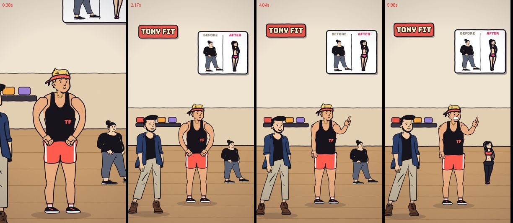 |
| 01 | 6.25–9.50 | 2. Twelve weeks. Real results. (Tony close-up, proud flex) | bgStudio | TONY | sign | cam, stars | L268–276 | 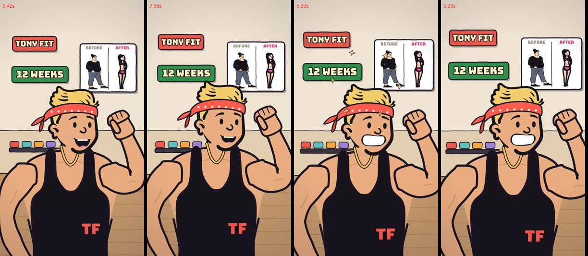 |
| 02 | 9.50–12.90 | 3. Good money... as long as he never stops (desk -> treadmill reveal) | bgStudio | TONY | bill, door, treadBack, treadFront | cam, ss | L277–292 | 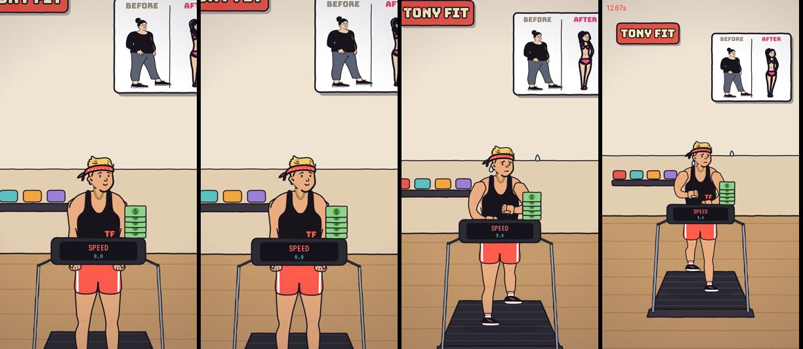 |
| 03 | 12.90–14.70 |  | twoDoors | TONY | — | cam | L293–299 | 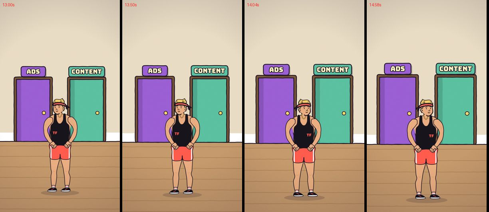 |
| 04 | 14.70–15.80 | 5a. Door number one: ads (door opens, push in) | twoDoors | — | — | cam, ei, ss | L300–305 | 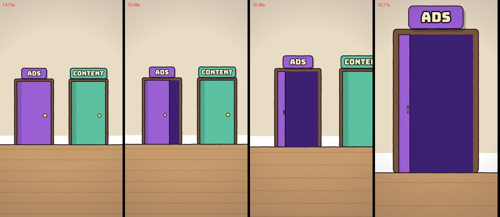 |
| 05 | 15.80–19.70 | 5b. Ads world: every client costs ~$200 | bgCasino | TONY, folk | adsMachine, bill | cam, eo | L306–320 | 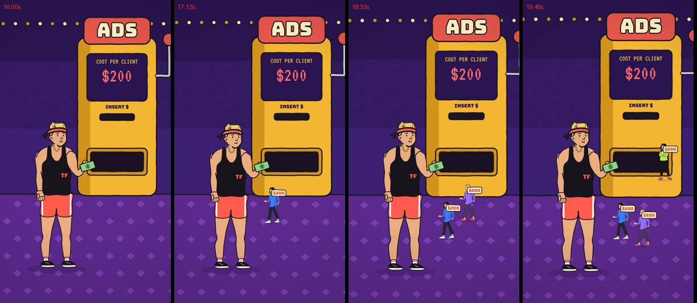 |
| 06 | 19.70–21.90 | 5c. Insert: every year the number goes up | bgCasino | — | adsMachine | cam, shake | L321–328 | 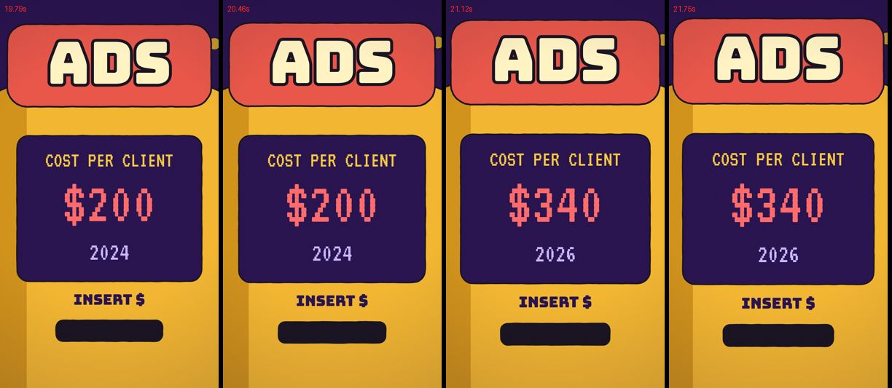 |
| 07 | 21.90–24.60 | 5d. Stop paying, and the clients stop (machine goes dark) | bgCasino | TONY, folk | adsMachine, bill | cam | L329–339 | 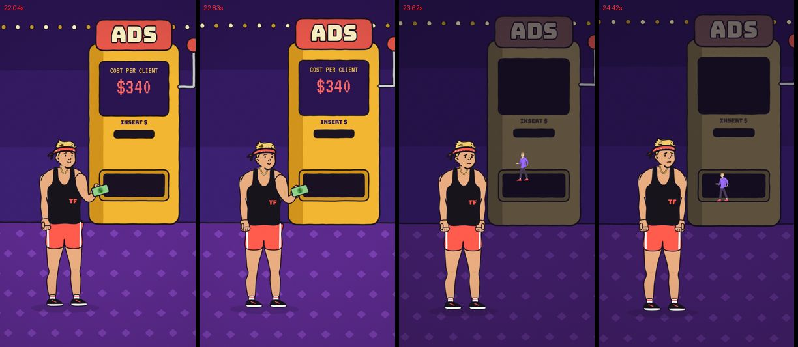 |
| 08 | 24.60–26.60 | 6a. Door number two: content | twoDoors | — | — | cam, ei, ss | L340–345 | 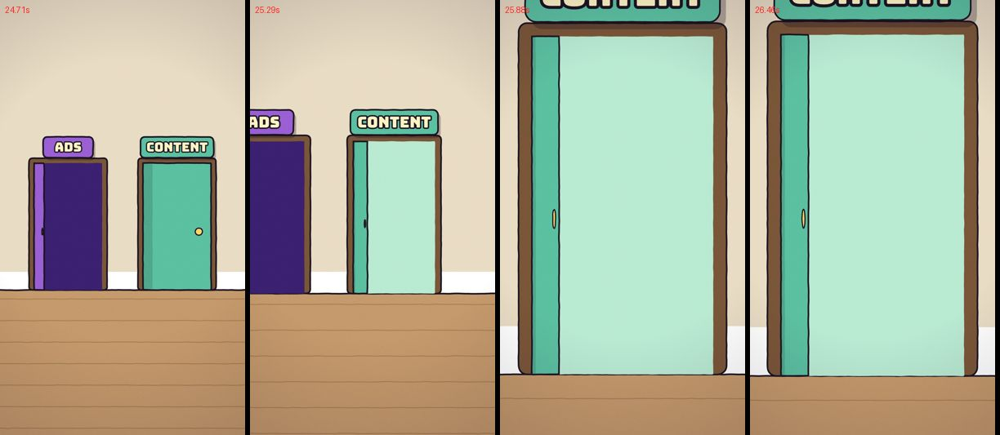 |
| 09 | 26.60–31.00 | 6b. 5 a.m. workout / noon meal prep / live at night / every single day (fast inserts) | bgContent | TONY | clock, phoneRig, softbox | cam | L346–360 | 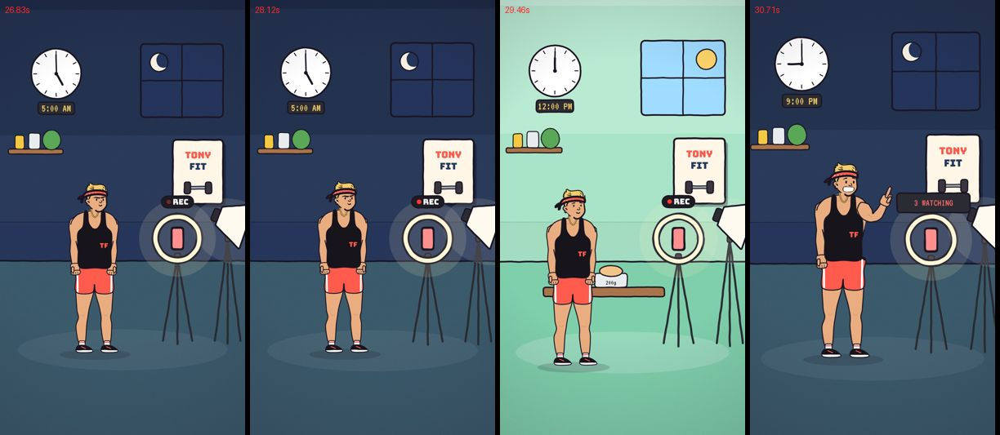 |
| 10 | 31.00–32.50 |  | bgContent | — | — | cam | L361–372 | 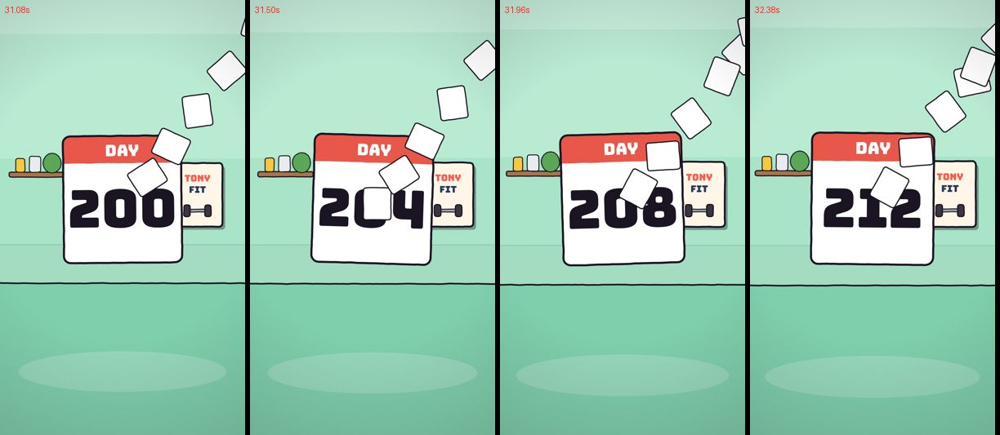 |
| 11 | 32.50–35.00 | 7. Tony: "If I miss a day, I feel it." (exhausted close-up, flickering ring light) | bgContent | TONY | sweatDrop | cam | L373–379 | 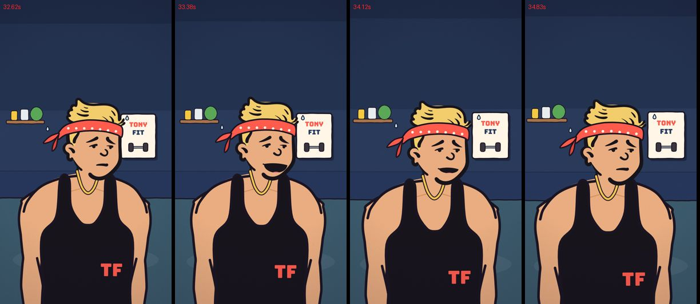 |
| 12 | 35.00–39.10 | 8. He does. One week off -> leads disappear (beach lounger, then poof) | beachSet | TONY, folk | — | cam, poof | L380–389 | 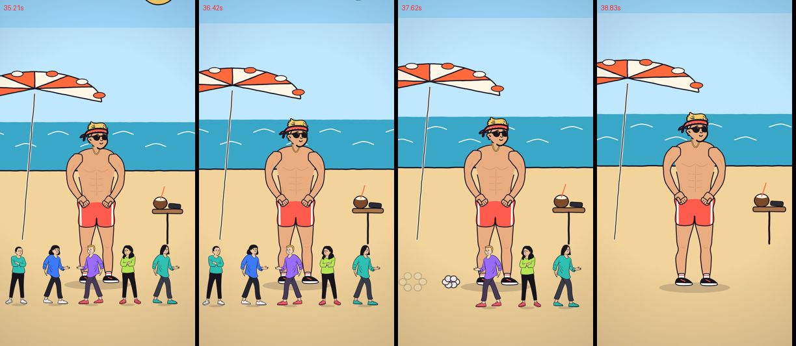 |
| 13 | 39.10–50.60 |  | bgOffice | TONY, folk | — | cam, pop1 | L390–406 | 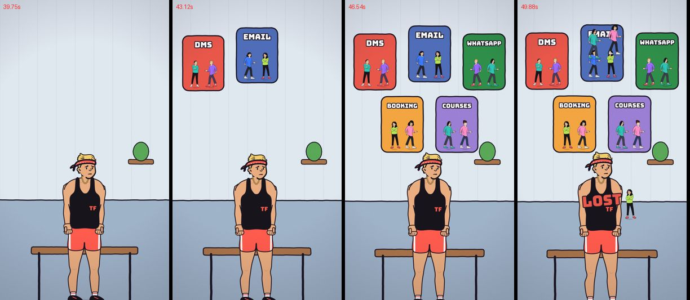 |
| 14 | 50.60–59.40 | 10. Algorithm changes / ad account flagged / traffic gone / never his | bgBoard | TONY, folk | door, panel, pill, sign | cam, eo, pop1, ss | L407–434 | 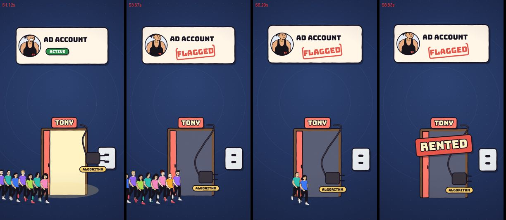 |
| 15 | 59.40–66.95 | 11-13. The math on the chalkboard | bgChalk | TONY | — | cam | L435–449 | 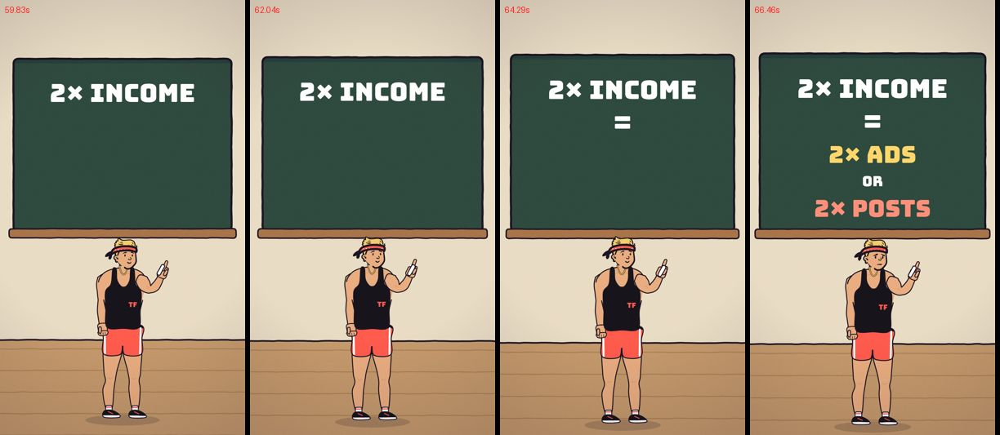 |
| 16 | 66.95–70.70 | 14. He's running on a treadmill (the business is a treadmill) | bgStudio | TONY | bill, treadBack, treadFront | cam, ss | L450–459 | 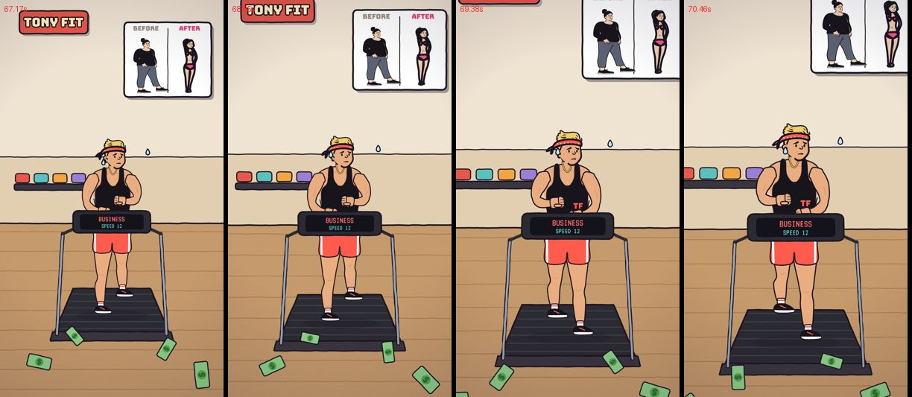 |
| 17 | 70.70–73.30 | 15. Tony: "So how do the big coaches grow?" (on the floor, Dex arrives) | bgStudio | DEX, TONY | — | cam | L460–467 | 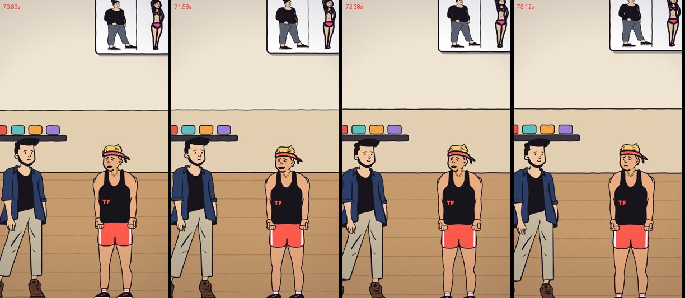 |
| 18 | 73.30–79.40 | 16. Look at Tony's clients: all from Tony, none from each other | bgBoard, gymFront | TONY, folk | arrow, xMark | cam, eo | L468–511 | 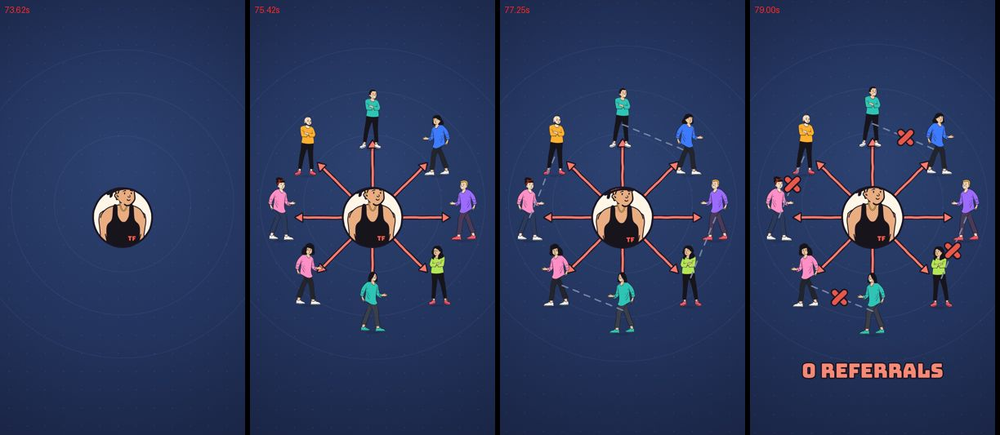 |
| 19 | 79.40–88.60 |  | gymFront | folk | pill, xMark | cam | L512–524 | 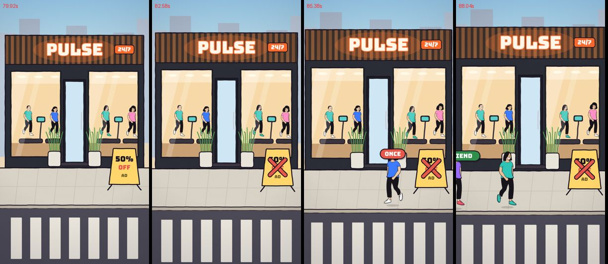 |
| 20 | 88.60–96.10 | 18. Not views. People sharing. One place to belong. | bgBoard | folk | arrow, panel, pill, xMark | cam, pop1, ss | L525–548 | 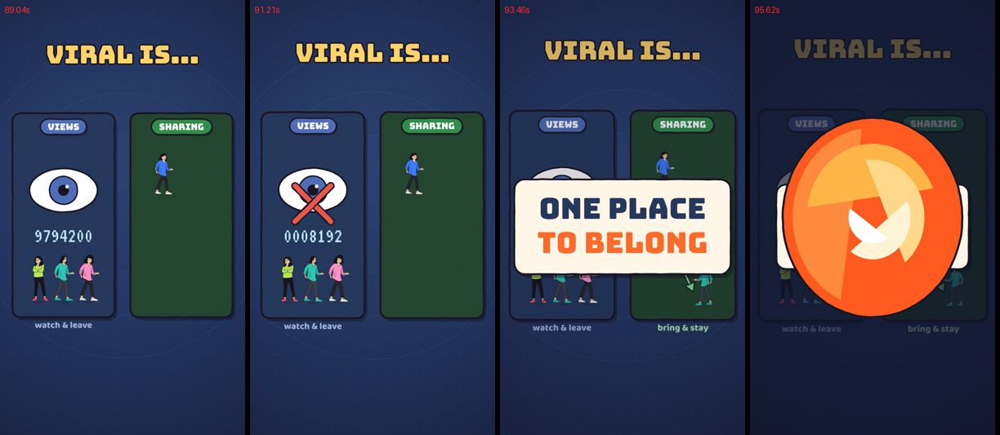 |
| 21 | 96.10–105.20 |  | bgCommunity | TONY, folk | arrow, door, pill | cam, eo, pop1 | L549–559 | 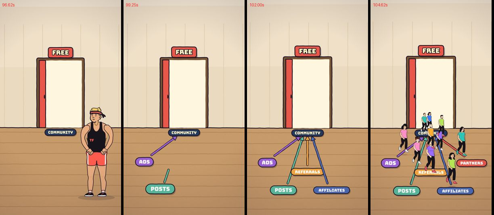 |
| 22 | 105.20–110.50 | 20. Joining is free. No checkout. Just a link. Easy to share. | bgCommunity | folk | xMark | cam, eio, pop1 | L560–572 | 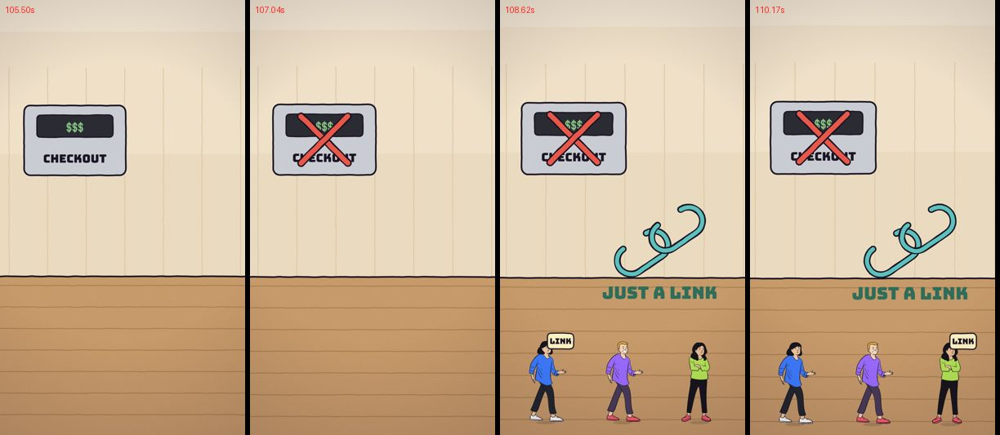 |
| 23 | 110.50–115.30 | 21. Inside: onboarding welcomes each person and shows them their path | bgCommunity | folk | sign | cam, eo, stars | L573–585 | 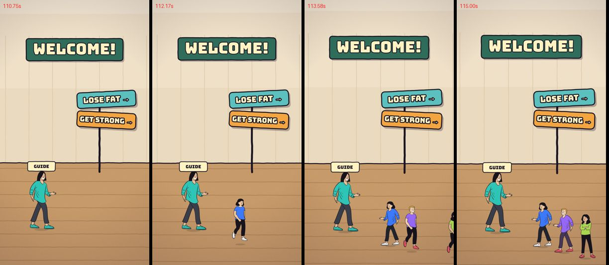 |
| 24 | 115.30–123.00 | 22. 5 minutes -> buy; day one -> results; week one -> full program | bgCommunity | folk | check, clock, panel, sign | cam, pop1, stars | L586–595 | 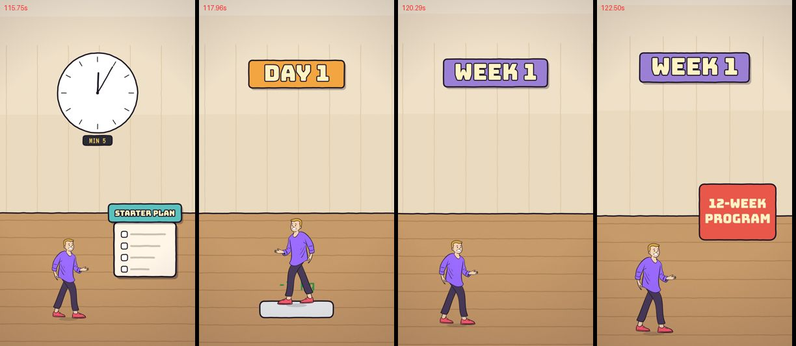 |
| 25 | 123.00–128.10 | 23. 30-day challenge: they're already inside. No ads. | bgCommunity | folk | adsMachine, xMark | back, cam | L596–604 | 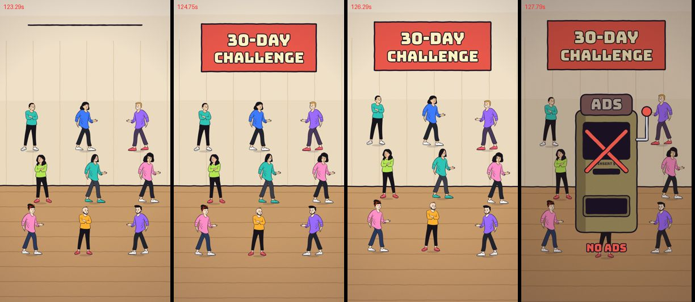 |
| 26 | 128.10–130.10 | 24. Tony whispers: "And they post their progress..." | bgCommunity | TONY, folk | — | cam | L605–612 | 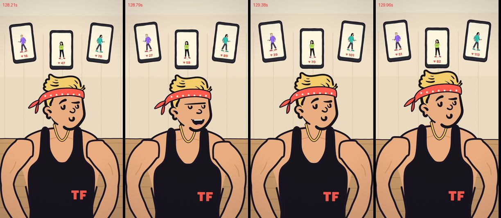 |
| 27 | 130.10–139.60 | 25. And bring their gym buddy... the viral loop | bgBoard, bgCommunity | folk | arrow, door | cam, pop1 | L613–633 | 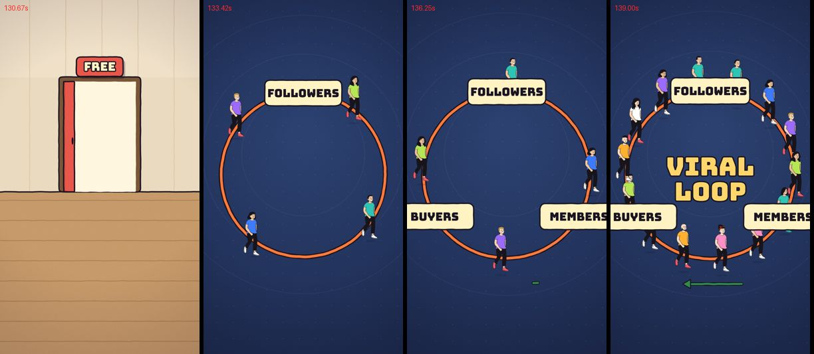 |
| 28 | 139.60–146.60 | 26. One month later... a week off (beach); "Did my leads disappear?"; "kept growing" | beachSet, bgBeach, bgBoard | TONY | — | back, cam, eo, pop1, ss, stars | L634–663 | 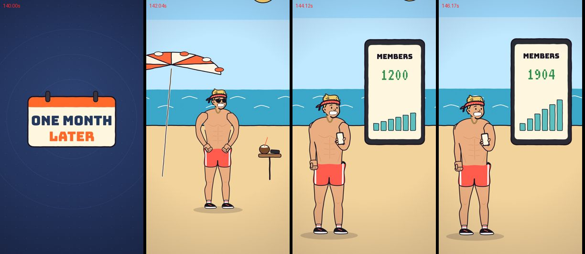 |
| 29 | 146.60–159.70 | 27. That's what Buzztorm builds | bgStage | DEX, TONY | cameraRig, check, sign, softbox | cam, pop1 | L664–676 | 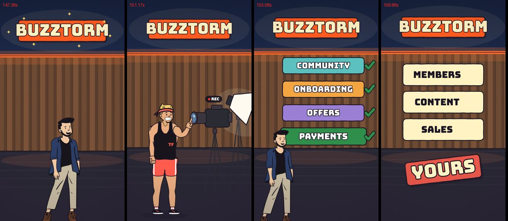 |
| 30 | 159.70–162.60 | 28. Honest fit: we'll tell you before you pay (Dex close-up) | bgStage | DEX | — | cam | L677–683 | 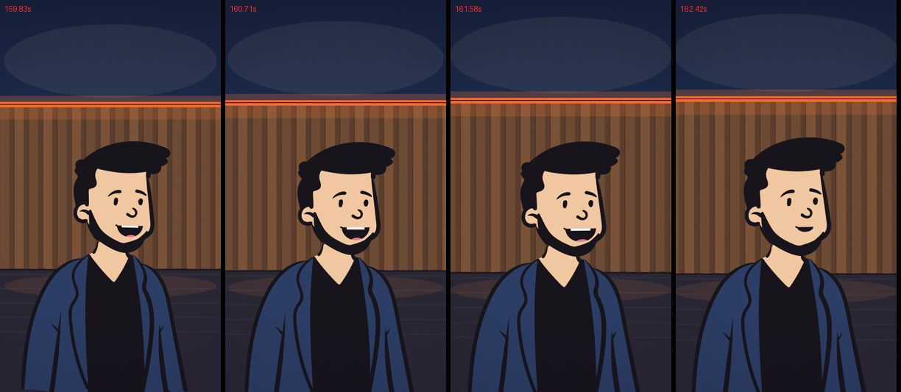 |
| 31 | 162.60–168.40 | 29. CTA: book a free 30-minute call at buzztorm.com — you'll leave with a plan | bgStage | DEX, TONY | — | cam, stars | L684–693 | 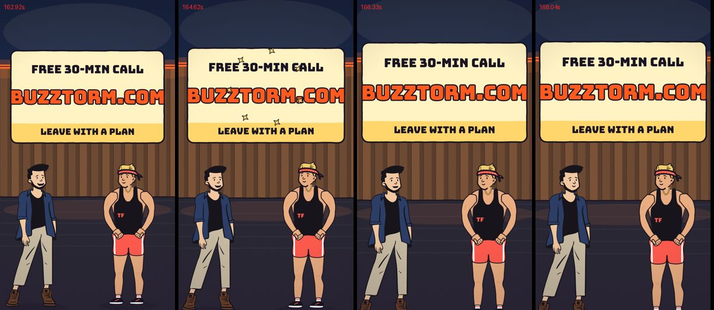 |
| 32 | 168.40–171.92 | 30. "Can I finally take off the ring light?" / "Please." / boing | bgStage | DEX, TONY | — | cam | L694–704 | 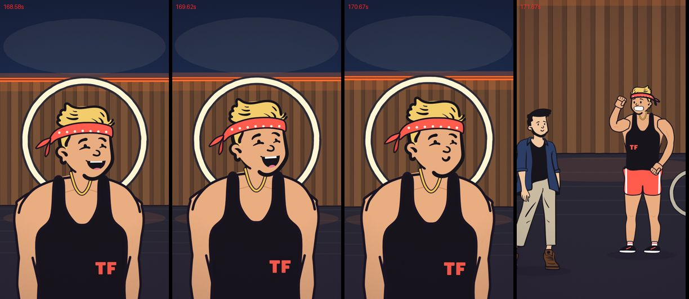 |
